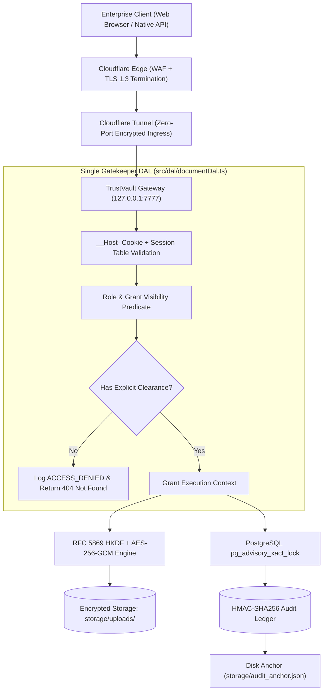
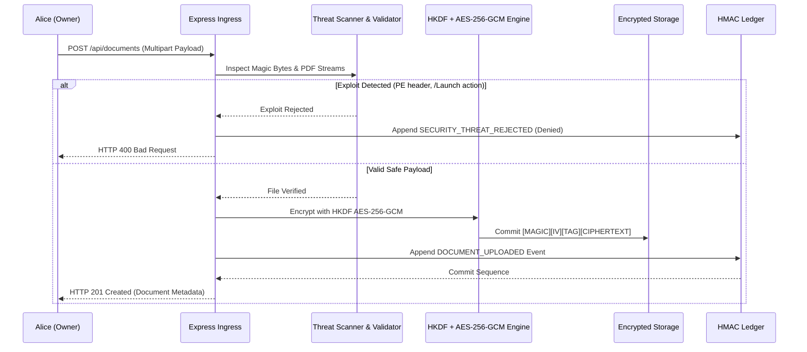

# 🏛️ TrustVault System Design & Zero-Trust Architecture Document

**System Name:** TrustVault Enterprise Document Vault  
**Security Standard:** RFC-Compliant Zero-Trust Cryptographic Architecture  
**Document Classification:** Production System Design Specification (SDS)  
**Host Environment:** Windows Server (`Akshar-ErpServer`: 12 vCPU cores, 32GB RAM)  
**Threat Specification:** 63 Modeled Vectors (`THREATS.md: T-01 to T-63`)  
**Automated Verification:** 12 Test Suites (87 Automated Tests) with 100% Mutation Resistance  

---

## 1. Architectural Philosophy & Zero-Trust Core

TrustVault is engineered around five non-negotiable architectural mandates:

1. **Verify Explicitly, Never Trust (NIST SP 800-207)**:
   Every request—regardless of network origin, user role, or past authorizations—is evaluated dynamically against database clearance state. Administrators have zero implicit access to private document contents without an explicit grant from the document owner.
2. **Fail-Closed Existence Shielding (Oracle Defense)**:
   If a user requests a document for which they possess zero access grants, the system returns **`HTTP 404 Not Found`**, strictly identical to a non-existent document. Returning `HTTP 403 Forbidden` would confirm the document's existence, leaking corporate intelligence (such as M&A targets or whistleblower files).
3. **Structural Impossibility via Single Gatekeeper DAL**:
   Access control is not scattered across controllers or duplicate middleware. Every single read, write, download, and permission operation flows through `loadDocumentFor()` in `src/dal/documentDal.ts`. Direct database client imports outside the DAL are prohibited via ESLint. Commenting out the gatekeeper causes tests to fail RED immediately.
4. **Tamper-Evident Cryptographic Ledger (Monotonic Immutability)**:
   Every security-sensitive event is committed to a sequential hash chain protected by **HMAC-SHA256**. The chain covers 13 canonical columns, utilizes PostgreSQL transaction advisory locking (`pg_advisory_xact_lock`), and anchors its head to disk (`storage/audit_anchor.json`).
5. **Single Credential Channel & Zero-Token Client**:
   Authentication is isolated to an `__Host-trustvault_token` cookie with `HttpOnly; Secure; SameSite=Strict; Path=/`. Response bodies emit zero token strings; client JavaScript holds zero tokens in memory or `localStorage`, neutralizing token exfiltration even in the event of XSS.



---

## 2. Cryptographic Data Flows

### 2.1 Document Ingestion & Envelope Encryption Flow
When an authorized user (`OWNER` or `ADMIN`) uploads a document:
1. **Memory Buffer Pipeline**: File is processed in temporary scratch storage (`storage/temp/`).
2. **Binary Magic-Byte Inspection**: Buffer analyzer checks file signatures (`fileSignature.ts`). Windows PE (`MZ`) and unauthorized extensions are rejected with `HTTP 400 Bad Request`.
3. **Heuristic Exploit Scanner**: Parses internal PDF object streams, rejecting weaponized `/Launch` execution commands, active `/JavaScript` streams, and embedded macro binaries.
4. **RFC 5869 HKDF Key Derivation & AES-256-GCM Encryption**:
   - Master envelope key derived via HKDF-SHA256 with domain salt `trustvault_storage_encryption_domain_salt_2026`.
   - File encrypted with AES-256-GCM using a unique 12-byte IV.
5. **Header Packing**: Formats an immutable envelope:
   $$\text{Envelope} = \left[ \text{MAGIC (17B)} \right] \parallel \left[ \text{IV (12B)} \right] \parallel \left[ \text{AUTH\_TAG (16B)} \right] \parallel \left[ \text{CIPHERTEXT} \right]$$
6. **Atomic Commit & Shred**: The encrypted blob is stored under an opaque UUID (no extension) outside the web root. Scratch files are immediately unlinked.



---

### 2.2 Secure Stream Delivery & Preview Attack Surface Elimination
To eliminate client-side PDF parser vulnerabilities (e.g. CVE-2024-4367 font execution in `pdfjs-dist`):
1. **Parser Removal**: Mozilla `pdfjs-dist` is completely removed from the client application.
2. **Strict Download Attachment**: All file deliveries stream decrypted bytes with `Content-Disposition: attachment; filename="..."` and `X-Content-Type-Options: nosniff`.
3. **Provenance Watermarking**: Watermarked documents incorporate steganographic zero-width Unicode tracking characters (`\u200B`, `\u200C`) and immutable PDF dictionary metadata mapping recipient identity and trace hashes.

---

### 2.3 Burn-on-Download Protocol (One-Time Transfer)
For high-confidentiality credentials and executive transfers:
1. Owner marks access grant with `burnOnDownload: true`.
2. Grantee initiates download: `GET /api/documents/:id/download`.
3. Server streams decrypted file to the HTTP response socket.
4. Express registers the socket listener:
   ```typescript
   res.on('finish', async () => {
     await burnDocumentPermission(document.id, user.id, user.email, reqContext);
   });
   ```
5. **Instant Self-Destruct**: Once bytes are fully transmitted, the permission grant is deleted in PostgreSQL and an audit event (`PERMISSION_BURNED_ON_DOWNLOAD`) is committed. The subsequent probe by the grantee evaluates `activeGrant = null` and returns `HTTP 404 Not Found`.

---

### 2.4 NIST SP 800-88 Cryptographic Sanitization
When documents are permanently destroyed:
1. `RetentionService.cryptoShredFile()` executes a 2-pass physical disk sanitization:
   - **Pass 1**: Overwrites all file sectors with cryptographically secure pseudorandom entropy (`crypto.randomBytes`).
   - **Pass 2**: Overwrites sectors with binary zeros (`0x00`).
   - **Force Sync**: Calls `fs.fdatasync()` to force physical flush to NVMe storage controllers before unlinking.
2. Removes all database records across `Document`, `DocumentVersion`, and `DocumentPermission`.
3. Past `AuditLog` rows remain strictly immutable because `documentId` is stored as an unconstrained snapshot string rather than a cascading foreign key.

---

## 3. Session Management & Instant Revocation

TrustVault implements a dual-tier session revocation model:

```
[Client Request] ──► [Extract __Host- Cookie] ──► [Verify JWT Signature]
                                                        │
                      ┌─────────────────────────────────┴─────────────────────────────────┐
                      ▼                                                                   ▼
       [Query Session Table (jti)]                                        [Compare tokenVersion]
       Is revokedAt != null?                                               Does token.ver == user.ver?
       ├─ YES ──► Reject 401 Unauthorized                                  ├─ NO  ──► Reject 401 Unauthorized
       └─ NO  ──► Proceed to Gatekeeper                                    └─ YES ──► Proceed to Gatekeeper
```

* **Per-Session Revocation (`/api/auth/logout`)**: Marks the specific `sessionId` as revoked in PostgreSQL and Redis. Concurrent evaluator sessions on shared seed accounts remain active.
* **Global Account Revocation (`tokenVersion`)**: Role promotions/demotions, password resets, and user deactivations increment `tokenVersion`, instantly severing all active sessions across all devices.

---

## 4. Runtime Database Role Separation

To protect the cryptographic audit ledger against insider tampering and SQL injection:
* **`trustvault_admin`**: DDL role used strictly for schema migrations.
* **`trustvault_app`**: Production runtime role strictly enforced at server startup via `assertNonPrivilegedRuntimeRole()`.
* **Immutability Enforcement**: PostgreSQL privileges `UPDATE`, `DELETE`, and `TRUNCATE` are explicitly revoked on `AuditLog` from `trustvault_app`. Any software-level mutation attempt throws SQL error `42501 permission denied`.
