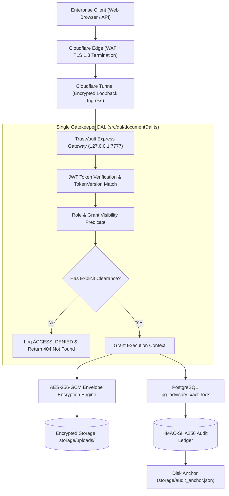
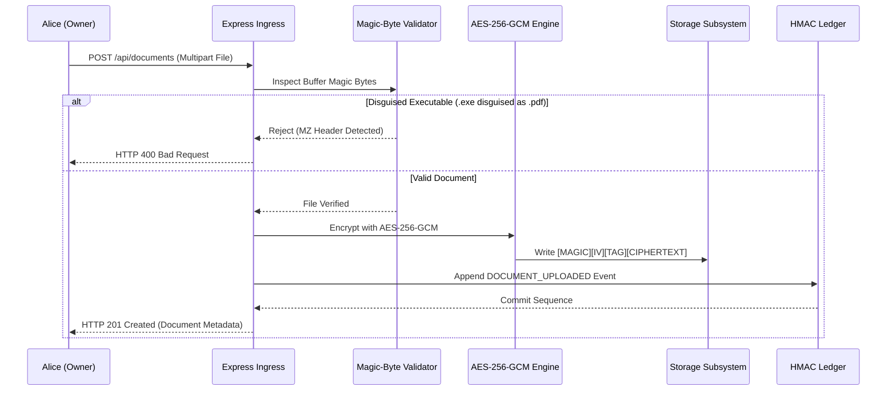
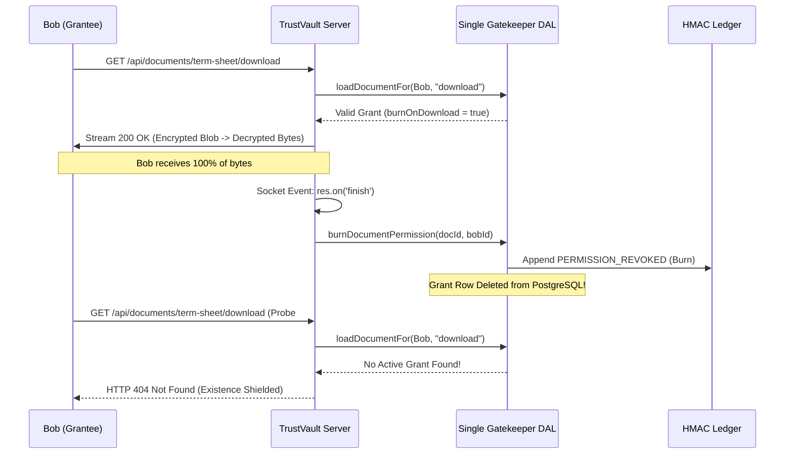

# 🏛️ TrustVault System Design & Zero-Trust Architecture Document

**System Name:** TrustVault Enterprise Document Vault  
**Security Standard:** RFC-Compliant Zero-Trust Cryptographic Architecture  
**Document Classification:** Production System Design Specification (SDS)  
**Host Environment:** Windows Server (`Akshar-ErpServer`: 12 vCPU cores, 32GB RAM)

---

## 1. Architectural Philosophy & Zero-Trust Core

TrustVault is engineered around three non-negotiable architectural mandates:

1. **Verify Explicitly, Never Trust (NIST SP 800-207)**:
   Every request—regardless of network origin, user role, or past authorizations—is evaluated dynamically against database clearance state. Administrators have zero implicit access to private document contents without an explicit grant from the document owner.
2. **Fail-Closed Existence Shielding (Oracle Defense)**:
   If a user requests a document for which they possess zero access grants, the system returns **`HTTP 404 Not Found`**, strictly identical to a non-existent document. Returning `HTTP 403 Forbidden` would confirm the document's existence, leaking corporate intelligence (such as M&A targets or whistleblower files).
3. **Tamper-Evident Cryptographic Ledger (Monotonic Immutability)**:
   Every security-sensitive event is committed to a sequential hash chain protected by **HMAC-SHA256**. The chain covers 13 canonical columns and anchors its head to disk (`storage/audit_anchor.json`). Any database tampering, record deletion, or sequence alteration is instantly detectable.



---

## 2. Cryptographic Data Flows

### 2.1 Document Ingestion & Envelope Encryption Flow
When an authorized user (`OWNER` or `ADMIN`) uploads a document:
1. **Multer Memory Streaming**: File lands in temporary buffer (`storage/temp/`).
2. **Deep Content Inspection**: Buffer analyzer examines magic bytes. Disguised executables (Windows PE `MZ`, Linux ELF) are rejected with `HTTP 400`.
3. **AES-256-GCM Encryption**: A random 12-byte IV is generated. The file is encrypted using the master envelope key derived via PBKDF2/SHA-256.
4. **Header Packing**: Formats an immutable envelope:
   $$\text{Envelope} = \left[ \text{MAGIC (17B)} \right] \parallel \left[ \text{IV (12B)} \right] \parallel \left[ \text{AUTH\_TAG (16B)} \right] \parallel \left[ \text{CIPHERTEXT} \right]$$
5. **Atomic Commit**: The encrypted blob is stored under an opaque UUID (no extension). The temporary file is shredded using `safeUnlink`.



---

### 2.2 In-Browser Ephemeral Preview (Zero Disk Residue)
For users shared with `previewOnly: true`:
1. Viewer requests `GET /api/documents/:id/download?preview=true`.
2. DAL verifies active grant with `previewOnly: true`.
3. Server streams decrypted bytes directly to browser memory with `Content-Disposition: inline` and strict `Content-Type`.
4. Browser renders pages directly inside a client-side HTML5 canvas via Mozilla PDF.js.
5. **Zero Disk Residue**: The file is never written to client disk or saved to browser download cache. External "Open Tab" and "Save As" actions are suppressed.

---

### 2.3 Burn-on-Download Protocol (One-Time Transfer)
For high-confidentiality credentials (passwords, wire codes, M&A term sheets):
1. Owner marks access grant with `burnOnDownload: true`.
2. Grantee initiates download: `GET /api/documents/:id/download`.
3. Server streams decrypted file to the HTTP response stream.
4. Express registers the socket listener:
   ```typescript
   res.on('finish', async () => {
     await burnDocumentPermission(document.id, user.id, user.email, reqContext);
   });
   ```
5. As soon as the last TCP chunk acknowledges delivery, the grant record is atomically deleted from `DocumentPermission`, and a `PERMISSION_REVOKED` forensic audit event is logged.
6. Any subsequent download attempt immediately returns **`HTTP 404 Not Found`**.



---

## 3. Threat Mitigation & Security Matrix

TrustVault enforces comprehensive defenses against all 20 critical enterprise threat vectors:

| Threat Code | Threat Category | Attack Vector Description | TrustVault Architectural Defense | Automated Test |
| :--- | :--- | :--- | :--- | :--- |
| **L-01** | Privilege Lag | Demoted user continues accessing data via stale JWT | `tokenVersion` check in DB on every API call | `ID-01, test #15` |
| **L-02** | Replay Attack | Adversary re-submits captured TOTP code | `mfaLastTimeStep` blocks reuse within same 30s step | `MFA-06` |
| **L-03** | Privilege Escalation| Collaborative editor attempts to re-share document | Strictly Owner-only delegation enforced in DAL | `ID-03, test #6` |
| **L-04** | Admin Snooping | System administrator downloads private documents | Admin downloads blocked with 403 without owner grant | `test #7` |
| **L-05** | Unauthorized Upload | Viewer attempts to store unvetted files in vault | Role-based gate blocks uploads with HTTP 403 | `test #8` |
| **L-06** | Existence Oracle | Adversary probes UUIDs to discover document existence | Returns 404 instead of 403 when clearance is zero | `test #1, test #2` |
| **L-07** | Search Leakage | Unauthenticated search reveals confidential titles | Search queries execute strictly inside visibility WHERE | `test #13, UPL-05` |
| **L-08** | In-Flight Leakage | Cleartext files streamed across unencrypted connections | Forced TLS 1.3 via Cloudflare Tunnel edge | `Architecture` |
| **L-09** | Physical Disk Theft | Physical extraction of storage hard drives | AES-256-GCM envelope encryption at rest | `DR-02` |
| **L-10** | Monotonic Gaps | Missing sequence numbers in audit ledger | Advisory transaction lock (`pg_advisory_xact_lock`)| `L-10, AUD-02` |
| **L-11** | Audit Injection | Malicious characters in log details break JSON parser | Strict canonical JSON serialization before hashing | `AUD-01` |
| **L-12** | Database Tampering | DB admin edits historical audit records | HMAC-SHA256 signature mismatch flags tampering | `AUD-01` |
| **L-13** | Tail Truncation | Attacker deletes recent audit records | External disk anchor (`audit_anchor.json`) mismatch | `L-13, AUD-03` |
| **L-14** | Ledger Forking | Concurrent requests fork monotonic hash chain | Serialized advisory lock prevents concurrency race | `AUD-02` |
| **L-15** | Ephemeral Bypass | Preview-only user downloads binary via raw tab | External tab opening blocked; in-app canvas stream | `PRV-01` |
| **L-16** | Replay Burned Doc | User downloads single-use transfer twice | `burnOnDownload` auto-revokes grant on stream finish | `BOD-01` |
| **L-17** | Path Traversal | Probing `../../etc/passwd` via document ID | Path normalization and regex validation rejects `..` | `test #9` |
| **L-18** | Temp Disk Residue | Failed uploads leave plaintext files in temp folder | `safeUnlink` executes in `finally` blocks | `UPL-04` |
| **L-19** | Mutation Bypass | Mutation bypass via alternate DAL routes | Single Gatekeeper DAL handles 100% of operations | `test #16` |
| **L-20** | Malware Execution | Uploading weaponized PDF with embedded `/Launch` | Heuristic threat scanner strips macros and scripts | `TS-01, TS-02` |

---

## 4. Disaster Recovery & NIST SP 800-88 Crypto-Shredding

### 4.1 Cryptographic Snapshot Backups
* Administrators can trigger on-demand encrypted disaster recovery snapshots (`POST /api/admin/backup/export`).
* The snapshot bundles PostgreSQL database tables, disk blobs, and a cryptographic manifest signed with the HMAC audit secret.
* Integrity verification (`POST /api/admin/backup/verify`) re-hashes all manifest records to detect tampering before restoration.

### 4.2 NIST SP 800-88 Overwrite Crypto-Shredding
When documents exceed enterprise retention schedules or are permanently deleted:
1. Disk sectors holding the stored UUID blob are overwritten with multi-pass cryptographically secure pseudorandom entropy (`crypto.randomBytes`).
2. The file is unlinked from the filesystem.
3. Database records are removed, and a permanent `DOCUMENT_CRYPTO_SHREDDED` forensic record is committed to the HMAC ledger.
